# Week 9: Kubernetes Fundamentals + Amazon EKS

> **Milestone: Migrate the stack to Kubernetes.**
> - Stand up an EKS cluster.
> - Package the backend (Parse Server) and frontend (Next.js) as a **Helm chart**: Deployments, Services, an **Ingress with TLS** (ACM), and **Secrets pulled from AWS Secrets Manager via IRSA**.
> - Add a **Horizontal Pod Autoscaler** and show it scaling under load.
>
> **Result:** the app ran on **https://w9.ebotprog.ink** on EKS (Kubernetes 1.37, eu-north-1). Secrets came from Secrets Manager through External Secrets + IRSA. The HPA scaled the frontend **2 → 6 → 2** under load. The environment was deleted after the demo to avoid cost; the screenshots are the evidence.

---

## 1. Architecture

```
                         Internet
                            │  https://w9.ebotprog.ink (Route 53 alias)
                            ▼
              ┌──────────────────────────────┐
              │ ALB (public subnets)          │  created by the AWS Load Balancer Controller
              │ :80  → 301 redirect to HTTPS  │  from the Kubernetes Ingress
              │ :443 → ACM certificate        │
              │   /parse* → backend:1337      │
              │   /*      → frontend:3000     │
              └──────────────┬───────────────┘
                             │ target-type: ip (straight to pod IPs)
   ┌─────────────────────────▼─────────────────────────────────────────┐
   │ EKS cluster "w9" · 2 × m7i-flex.large nodes in private subnets    │
   │                                                                   │
   │  namespace crud                                                   │
   │   ├─ Deployment frontend (2–6 pods) ◄── HPA (CPU 60%)             │
   │   ├─ Deployment backend  (2 pods)  ◄── Secret backend-secrets     │
   │   │                                       ▲                       │
   │   └─ ExternalSecret ──────────────────────┘                       │
   │                                                                   │
   │  kube-system: AWS Load Balancer Controller (IRSA role #1)         │
   │  external-secrets: External Secrets Operator (IRSA role #2) ──────┼──► AWS Secrets Manager
   │  add-ons: VPC CNI · CoreDNS · kube-proxy · metrics-server         │      crud/backend
   └───────────────────────────────┬───────────────────────────────────┘
                                   │ NAT gateway (one fixed public IP)
                                   ▼
                          MongoDB Atlas (IP allow-list)
```

| Piece | What it does | How it was set up |
|---|---|---|
| **EKS control plane** | AWS-managed Kubernetes API, etcd, scheduler | `eksctl create cluster -f eks/cluster.yaml` |
| **Managed node group** | 2 EC2 worker nodes in private subnets | in `cluster.yaml` |
| **VPC CNI** | Gives every pod a real VPC IP; network policy enforcement enabled | EKS add-on |
| **AWS Load Balancer Controller** | Turns the Ingress into an ALB (listeners, rules, target groups) | Helm, with IRSA role #1 |
| **External Secrets Operator** | Copies `crud/backend` from Secrets Manager into a Kubernetes Secret | Helm, with IRSA role #2 |
| **metrics-server** | CPU/memory numbers for the HPA and `kubectl top` | EKS add-on |
| **The app** | Helm chart `charts/crud` | `helm upgrade --install … -f values-prod.yaml` |

---

## 2. Repository layout

```
.
├── charts/crud/                     # THE DELIVERABLE: Helm chart
│   ├── Chart.yaml
│   ├── values.yaml                  # defaults
│   ├── values-kind.yaml             # local kind cluster
│   ├── values-prod.yaml             # EKS (ECR images, HTTPS, HPA, ExternalSecret)
│   └── templates/
│       ├── backend.yaml             # ConfigMap + Deployment + Service (named port, ALB health check)
│       ├── frontend.yaml            # ConfigMap + Deployment (no replicas when HPA is on) + Service
│       ├── hpa.yaml                 # HorizontalPodAutoscaler (autoscaling/v2)
│       ├── ingress.yaml             # ALB Ingress; HTTPS only when a certificate ARN is set
│       ├── externalsecret.yaml      # Secrets Manager → Secret backend-secrets
│       └── servicemonitor.yaml      # Week 11 (Prometheus), off by default
├── eks/                             # cluster + platform scripts (run in AWS CloudShell)
│   ├── cluster.yaml                 # eksctl ClusterConfig incl. IRSA service accounts
│   ├── setup-cloudshell.sh          # installs eksctl/kubectl/helm into ~/bin
│   ├── platform-install.sh          # Load Balancer Controller + External Secrets (Helm)
│   ├── cluster-secret-store.yaml    # where/how ESO authenticates (IRSA)
│   ├── create-app-secret.sh         # puts DATABASE_URI / MASTER_KEY into Secrets Manager (hidden input)
│   ├── acm-certificate.sh           # requests + DNS-validates the TLS certificate via Route 53
│   ├── dns-alias.sh                 # Route 53 alias w9.ebotprog.ink → ALB
│   └── nat-ip.sh                    # NAT public IP for the Atlas allow-list
├── argocd/crud-prod.yaml            # Week 10
├── monitoring/                      # Week 11
└── screenshots/
```

---

## 3. Key design decisions

| Decision | Why |
|---|---|
| **Helm chart, one set of templates + a values file per environment** | The same templates run on kind (`values-kind.yaml`) and EKS (`values-prod.yaml`), so nothing is copied by hand |
| **Secrets: Secrets Manager → External Secrets → Kubernetes Secret** | Git only holds a *pointer* (`secretsManagerKey: crud/backend`). Values are encrypted with KMS (`aws/secretsmanager`) and never in the repo |
| **IRSA instead of node permissions or access keys** | Each controller gets its **own** IAM role, limited to one ServiceAccount (`sub = system:serviceaccount:<ns>:<name>`). The ESO role can only read `crud/backend-*` |
| **One ALB via Ingress (not a LoadBalancer Service per app)** | One public entry point. Path routing (`/parse` → backend, `/` → frontend) means one domain and no CORS issues |
| **ACM certificate on the ALB (not cert-manager)** | An ALB can only use ACM certificates. ACM renews automatically and for free |
| **`target-type: ip`** | The ALB sends traffic straight to pod IPs (VPC CNI), like Week 8's Fargate targets |
| **Ingress template: HTTPS only if `certificateArn` is set** | Added during the domain outage (section 6) so the app could run over HTTP; switching to HTTPS is one value change |
| **Rolling update `maxSurge 1 / maxUnavailable 0`, readiness probes** | A new pod must be Ready before an old one is removed, so there's no capacity loss during rollouts |
| **No `replicas:` in the frontend Deployment when the HPA is on** | Otherwise every deploy would reset the HPA's count |
| **Backend has a fixed replica count (2)** | Lets Week 10 demonstrate ArgoCD self-healing on a field Git owns |
| **Nodes in private subnets + NAT** | Pods aren't reachable from the internet. Atlas only accepts the NAT IP |
| **`m7i-flex.large` nodes** | The account's Free plan rejects t3.medium; this Free-plan-eligible type has more RAM (8 GiB) and pod slots (~29/node) |

---

## 4. How it was built (commands)

```bash
# CloudShell (eu-north-1)
bash setup-cloudshell.sh && source ~/.bashrc
eksctl create cluster -f eks/cluster.yaml          # VPC, control plane, nodes, OIDC, IRSA, add-ons
aws eks update-kubeconfig --region eu-north-1 --name w9
bash eks/acm-certificate.sh                        # TLS cert, validated through Route 53
bash eks/create-app-secret.sh                      # crud/backend in Secrets Manager
bash eks/platform-install.sh                       # Load Balancer Controller + External Secrets
bash eks/nat-ip.sh                                 # → Atlas Network Access
helm lint charts/crud -f charts/crud/values-prod.yaml
helm upgrade --install crud charts/crud -n crud --create-namespace -f charts/crud/values-prod.yaml --wait
bash eks/dns-alias.sh                              # w9.ebotprog.ink → ALB
```

The images come from the Week 3/11 pipeline: they're built, **scanned by Trivy (security gate)**, and pushed to ECR with the commit SHA as the tag (`a8efed06…`).

---

## 5. Evidence

### 5.1 Cluster
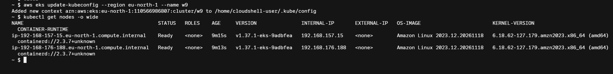
*2 nodes Ready, Kubernetes v1.37.1, **private** 192.168.x.x IPs only (no external IP), containerd runtime.*

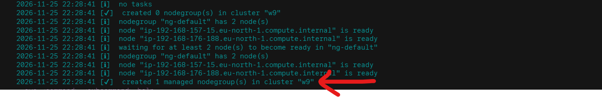

### 5.2 TLS certificate and secret
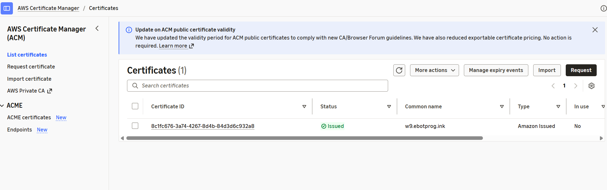
*ACM certificate for w9.ebotprog.ink: **Issued** (DNS-validated through Route 53).*

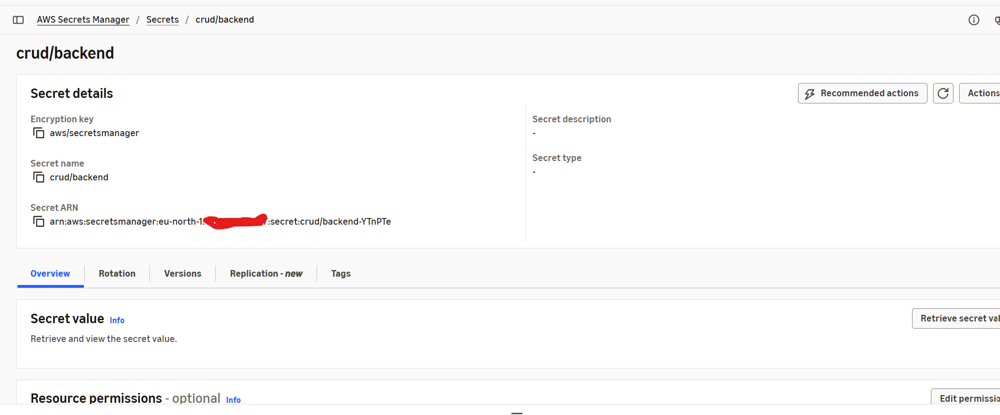
*`crud/backend` in Secrets Manager, encrypted with the KMS key `aws/secretsmanager`. The ARN suffix `-YTnPTe` is why the IRSA policy uses `crud/backend-*`.*

### 5.3 Platform add-ons (IRSA working)
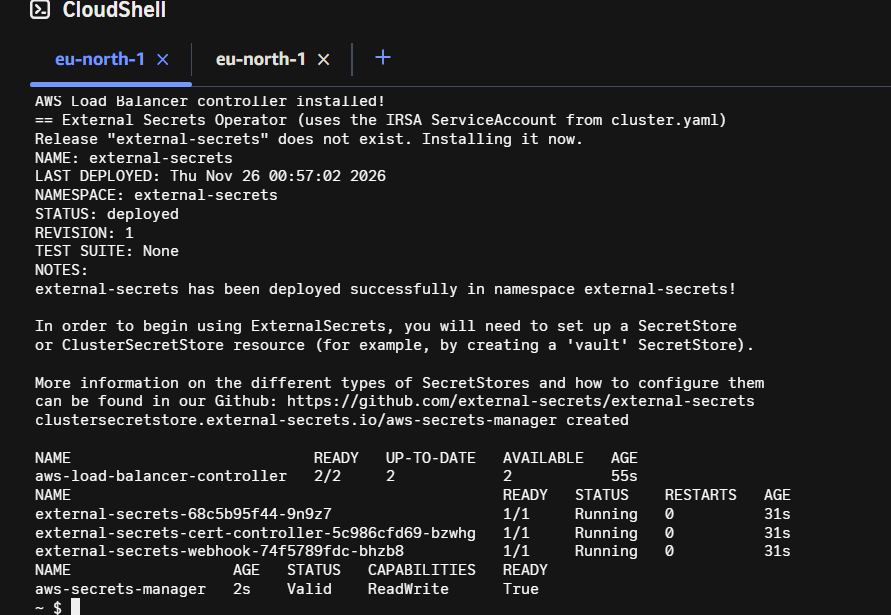
*Load Balancer Controller 2/2, External Secrets running, and the **ClusterSecretStore is `Valid / Ready True`**, which proves External Secrets authenticated to AWS through IRSA.*

### 5.4 The app on EKS
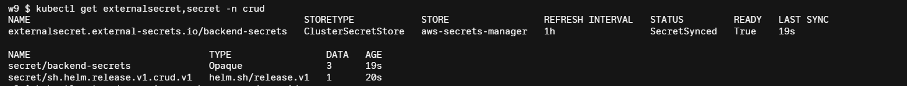
*ExternalSecret `SecretSynced` → Secret `backend-secrets` with 3 keys (DATABASE_URI, MASTER_KEY, MAINTENANCE_KEY).*

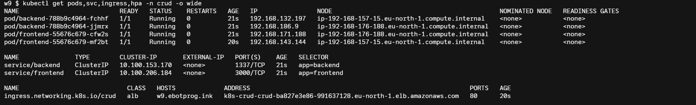
*2 backend + 2 frontend pods **spread across both nodes**, VPC IPs, ClusterIP Services, and an Ingress with the ALB address.*

### 5.5 HTTPS
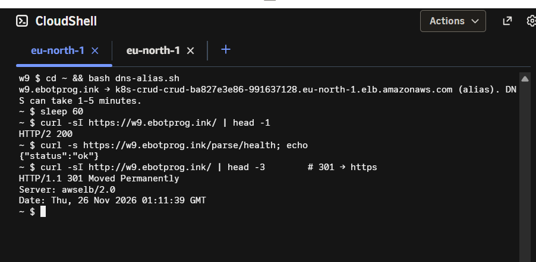
*HTTPS → `HTTP/2 200`; `/parse/health` → `{"status":"ok"}`; HTTP → **301** from `awselb/2.0` (forced HTTPS).*

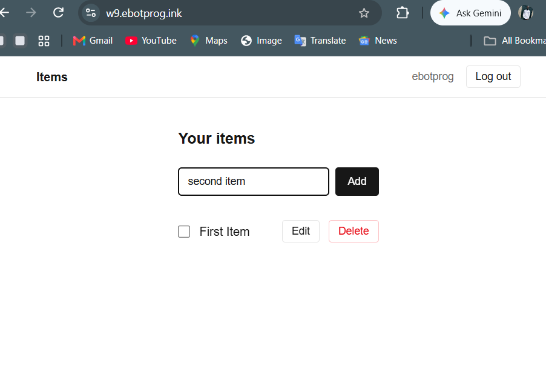

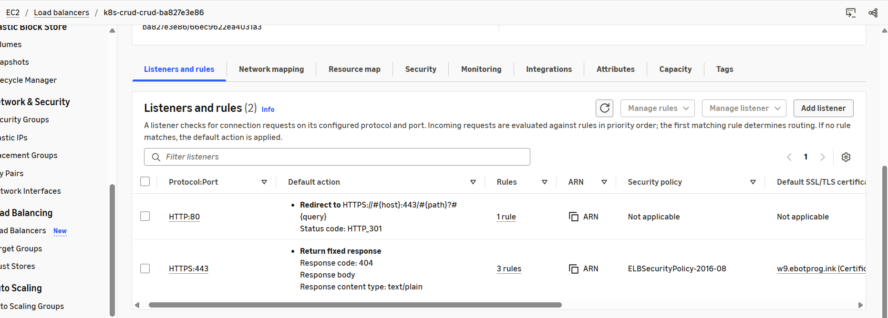
*ALB listeners built from the Ingress: :80 = redirect; :443 = ACM certificate + 3 rules (host + path); default = 404.*

### 5.6 Self-healing
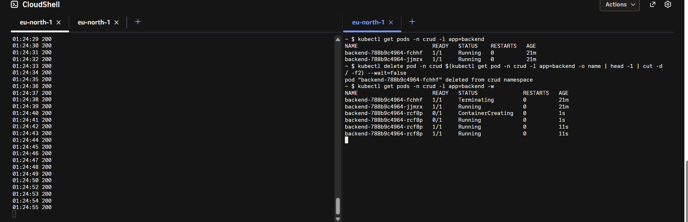
*A backend pod deleted while `curl` hit the site every second: **every response 200**. The ReplicaSet created a replacement that was Ready in ~11 s.*

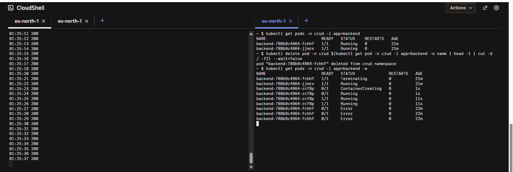
*The deleted pod briefly shows `Error`: Node.js has no SIGTERM handler, so it exits with code 143 (128 + SIGTERM 15). There was no user impact. Fix listed in section 8.*

### 5.7 Horizontal Pod Autoscaler (the demo deliverable)
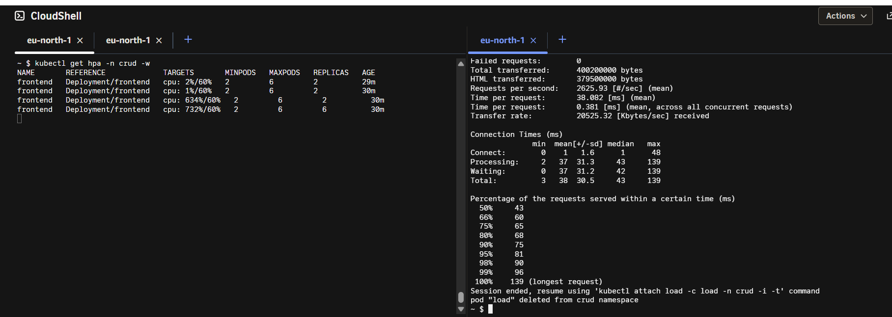
*In-cluster load test (ApacheBench, 100 concurrent): frontend CPU **2% → 732%** of its request → HPA **2 → 6** replicas (max) in about a minute. 0 failed requests, ~2,600 req/s, p95 81 ms.*

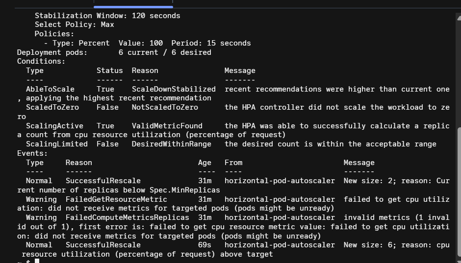
*Event: "New size: 6; reason: cpu resource utilization (percentage of request) above target". The condition `ScaleDownStabilized` shows the 120 s stabilization window.*

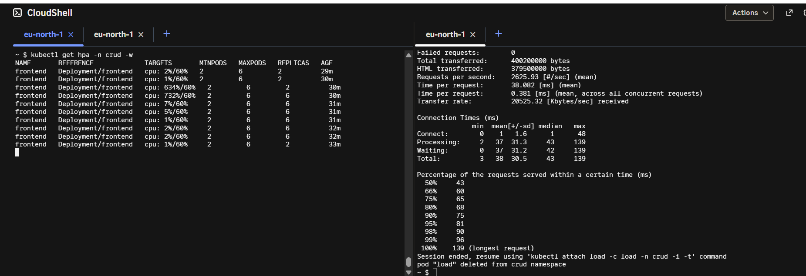
*After the load: CPU 1–7%, the window passes, **6 → 2**.*

---

## 6. Problems I hit and how I solved them

| # | Problem | Cause | Fix |
|---|---|---|---|
| 1 | Node group stuck, then `ROLLBACK_COMPLETE` | **AWS Free plan:** `InvalidParameterCombination – The specified instance type is not eligible for Free Tier` (t3.medium) | Found it with `describe-stack-events`. Listed eligible types (`free-tier-eligible=true`) and used **m7i-flex.large** (2 vCPU, 8 GiB, x86_64): 2 nodes instead of 3 |
| 2 | Couldn't delete the failed stack | eksctl turns on CloudFormation **termination protection** | `update-termination-protection --no-enable-termination-protection`, then delete |
| 3 | `kubectl` → `localhost:8080 connection refused` ([screenshot](screenshots/issue-02-kubectl-localhost-8080-no-kubeconfig.png)) | CloudShell disconnected while idle; eksctl writes the kubeconfig only at the end ([screenshot](screenshots/issue-01-eksctl-output-cut-at-nodegroup.png)) | `aws eks update-kubeconfig --region eu-north-1 --name w9` |
| 4 | ACM certificate stuck in `PENDING_VALIDATION` | The **domain was suspended by the registrar**: its public nameservers were `failed-whois-verification.namecheap.com` (unverified registrant email, an ICANN rule). Found with a DNS-over-HTTPS lookup | Verified the email ([screenshot](screenshots/issue-03-namecheap-registrant-verified.png)); the nameservers already pointed at Route 53 ([screenshot](screenshots/issue-04-namecheap-custom-dns-route53.png)). Reactivated within ~10 min; ACM issued automatically. Made the Ingress TLS-optional as Plan B meanwhile |
| 5 | Local `kubectl` → "provide credentials" | My PC's AWS CLI identity ≠ the cluster creator (CloudShell) | Added an **EKS access entry** + `AmazonEKSClusterAdminPolicy` for the PC identity |
| 6 | Cleanup: `eksctl delete` → `ExpiredToken` / "failed to refresh cached credentials" | ~7 h console session; eksctl couldn't refresh CloudShell's credentials; exported keys expire after ~10 min | A retry loop that loads fresh temporary keys each attempt until the cluster is gone |
| 7 | Network stack `eksctl-w9-cluster` → `DELETE_FAILED` ("subnet … has dependencies") | A leftover **VPC CNI network interface** (`aws-K8S-i-…`, status `available`) from a terminated node was still in a private subnet, plus the cluster security group | Found it with `describe-network-interfaces` on the VPC, deleted the ENI and SG, disabled termination protection, deleted the stack again |

---

## 7. Cost and cleanup

- **Running cost:** about $0.35–0.40/hour (EKS control plane $0.10/h, 2 × m7i-flex.large, NAT gateway, ALB), paid from Free-plan credits. Total for the session: about $3.
- **Deleted the same day, in this order:**
  1. Route 53 alias.
  2. ArgoCD Application → its finalizer removed the Ingress → the controller removed the **ALB**.
  3. `eksctl delete cluster` (nodes, IRSA roles, OIDC provider, control plane, VPC, NAT, Elastic IP).
     The network stack needed a manual fix (problem 7), then **verified: no cluster, no `eksctl-w9-*` stacks, no NAT gateways, no Elastic IPs, no load balancers** ([screenshot](screenshots/W9-14-cleanup-verified-all-empty.png)).
  4. Secrets Manager secret.
  5. ACM certificate.
- **Kept on purpose:** the ECR repositories, the GitHub OIDC role (CI), and the Route 53 hosted zone.

---

## 8. Honest gaps and next steps

- **Terraform:** the brief says "eksctl to start, then codify in Terraform". The cluster was built with eksctl (declarative `cluster.yaml`, CloudFormation underneath). Next: `terraform-aws-modules/vpc` + `terraform-aws-modules/eks`, with the S3 + DynamoDB remote state from Week 8.
- **Graceful shutdown:** add a SIGTERM handler (`server.close()` → `exit 0`) so pods end as `Completed`, not `Error`.
- **Node autoscaling:** only pods scale (HPA). Next: Cluster Autoscaler or Karpenter, for when pods no longer fit.
- **Root user:** the cluster was operated from CloudShell as the **root user**. Next: an IAM Identity Center user with MFA and least privilege (see the Week 11 IAM audit).
- **Pod Identity:** AWS's newer alternative to IRSA (no OIDC provider per cluster).
